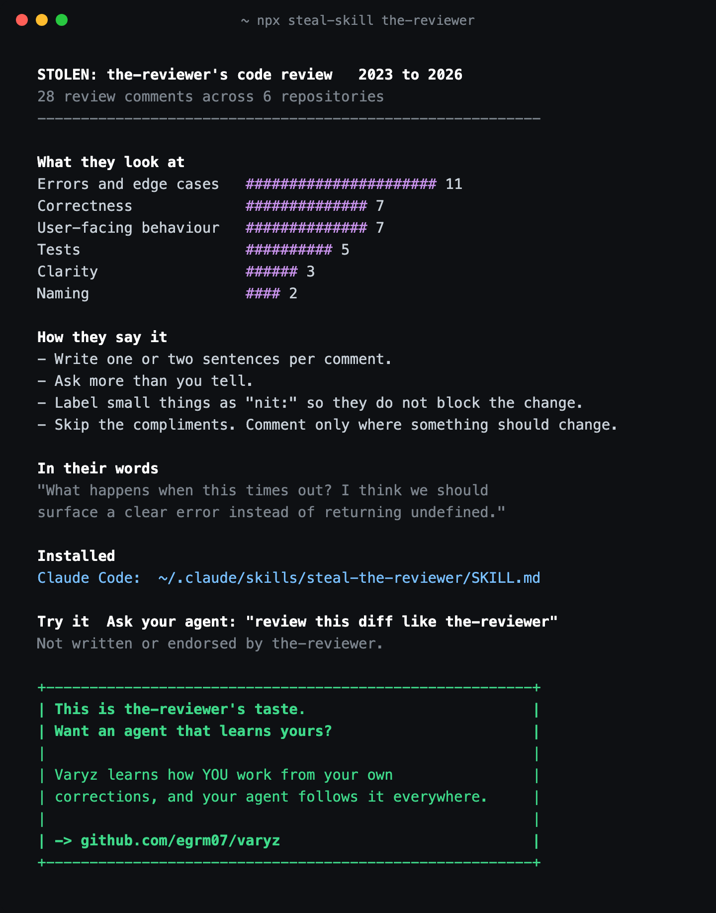
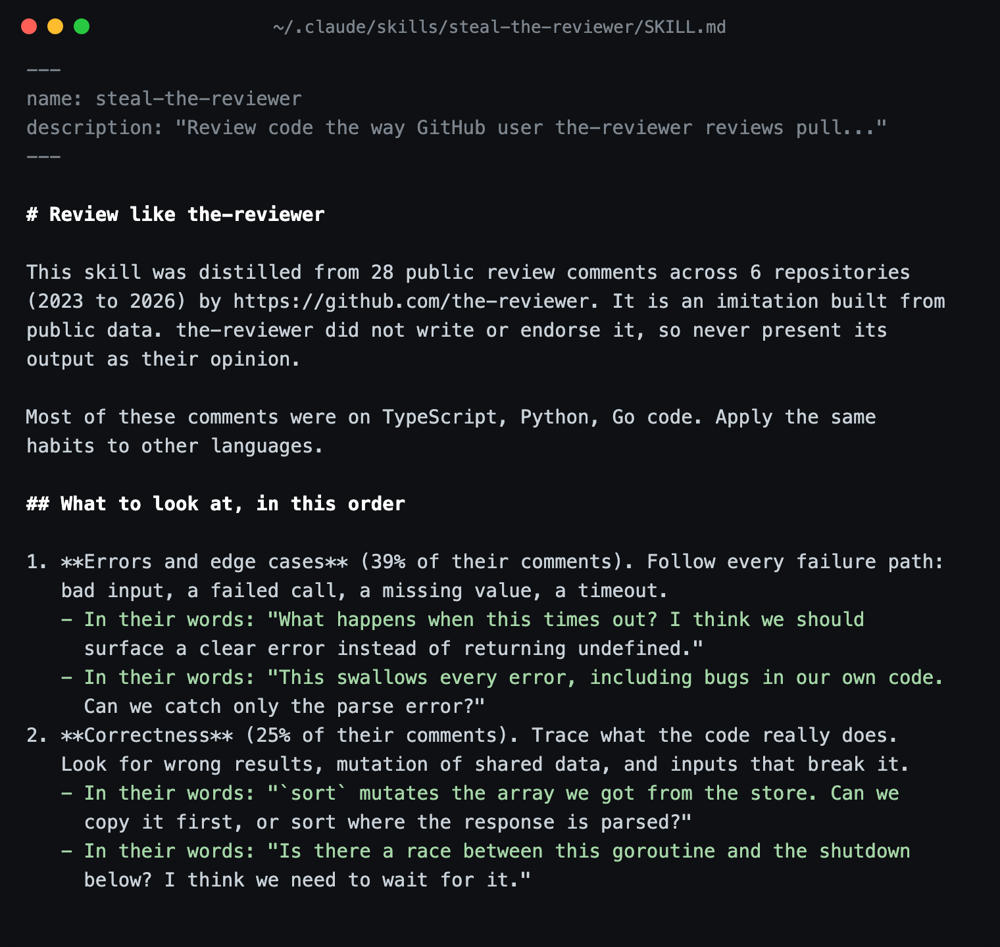

# steal-skill

**Steal any developer's code review taste.** steal-skill reads a GitHub user's public pull request reviews and turns them into a skill your AI agent can use. Then you ask for a review like theirs.

```bash
npx steal-skill <github-user>
```

Then, in Claude Code or Codex:

```text
review this diff like <github-user>
```

No install and no API key. It reads public GitHub data, and nothing is posted anywhere.

<p align="center">
  
</p>
<p align="center"><sub>Sample run on a made-up reviewer, from <code>npm run demo</code>.</sub></p>

## What you get

A `SKILL.md` your agent loads on its own whenever you ask for a review in that person's style:

- **What to look at, in their order.** Tests, errors, naming, correctness, clarity and so on, ranked by how often they actually raise each one, with real quotes.
- **How to say it.** Short or thorough, questions or statements, "nit:" or not, "we" or "you". Every line is backed by a measured rate.
- **Real examples.** The code they were looking at and exactly what they said about it.

<p align="center">
  
</p>

It is installed for **Claude Code** (`~/.claude/skills`) and, when you have it, **Codex** (`~/.codex/skills`).

## Ideas

- The maintainer of the library you contribute to, before you open the PR.
- Your tech lead, so the first round of comments happens before they see it.
- The reviewer you learned the most from.
- Yourself. See what your own reviews say about you.

## How it works

1. Finds pull requests the user reviewed or commented on, excluding their own (GitHub search).
2. Reads their inline review comments, review summaries and thread comments on those pull requests.
3. Strips code blocks, quoted replies, links and @mentions, keeping only their own words.
4. Counts what they comment on and how they phrase it. Plain counting, no AI calls, so the same comments always give the same skill.
5. Writes the skill and installs it.

With a GitHub token it reads up to 80 pull requests. It finds one in `GITHUB_TOKEN`, `GH_TOKEN` or the `gh` CLI (`gh auth login`), and sends it only to `api.github.com`. Without one it reads 18, which fits inside GitHub's 60 requests an hour. Results are cached for a day in `~/.cache/steal-skill`.

## Fair use

- Only public review comments are read.
- Every skill says, in its description and its body, that the person **did not write or endorse it**, and tells the agent never to present its output as their opinion.
- Reviews written with it end with *"Reviewed in the style of &lt;user&gt;, via steal-skill"*.
- Nothing is posted, and no one is mentioned or notified.

## Options

```text
npx steal-skill <user>           Build and install the skill
npx steal-skill list             Show installed steal-skill skills
npx steal-skill remove <user>    Remove one

--print          Print SKILL.md instead of installing it
--out DIR        Write the skill to DIR
--project        Install into ./.claude/skills for this project only
--max-prs N      How many pull requests to read
--fresh          Ignore the cache
--json           Print the profile as JSON
```

steal-skill never overwrites a skill it did not make.

## Requirements

Node.js 18 or newer. Zero dependencies.

```bash
git clone https://github.com/egrm07/steal-skill && cd steal-skill && npm test
```

---

<h2 align="center">That's their taste. Want an agent that learns yours?</h2>

<p align="center">
steal-skill copies someone else's habits from what they wrote in public.<br>
<b><a href="https://github.com/egrm07/varyz">Varyz</a></b> learns <b>your</b> habits from the corrections you give your own agents,<br>
turns them into rules, and makes every agent you use follow them. Works with Claude Code, Codex and Cursor.
</p>

<p align="center">
  <a href="https://github.com/egrm07/varyz"><b>github.com/egrm07/varyz</b></a>
</p>

---

MIT licence. Not affiliated with GitHub. Skills built with this tool imitate public writing and are not endorsed by the people they are built from.
